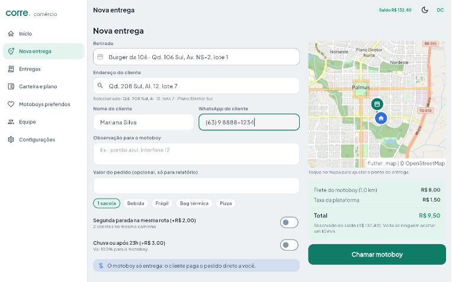
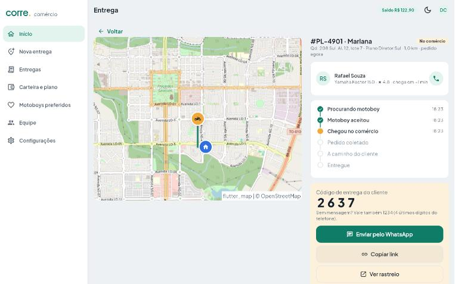
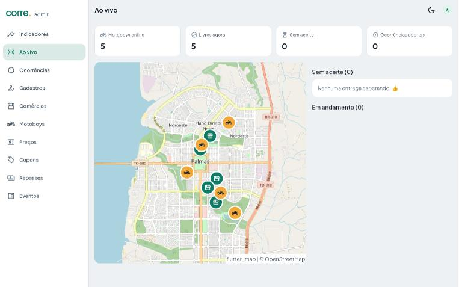

# Corre — entregas sob demanda para comércios locais

Plataforma de entregas feita para Palmas-TO: lanchonetes, restaurantes, farmácias e outros comércios pedem um motoboy pelo painel web, e o motoboy mais próximo e disponível aceita a corrida pelo app no celular. O comércio paga um frete fixo por distância mais uma taxa pequena por entrega, sem porcentagem sobre o valor do pedido.

Esta é a **primeira versão (front-end completo com dados simulados)**. Todas as telas funcionam de ponta a ponta, mas ainda não existe servidor: os dados ficam no próprio aparelho e um simulador faz o papel dos outros motoboys e comércios.

## Demonstração ao vivo

| O quê | Link |
|---|---|
| Painel do comércio, suporte e admin | https://corre-painel.vinicius-codfy.workers.dev |
| App do motoboy (versão web, abra no celular) | https://corre-motoboy.vinicius-codfy.workers.dev |
| Catálogo do design system | https://corre-design-system.vinicius-codfy.workers.dev |

No painel, escolha o perfil na tela de entrada (dono do comércio, atendente, suporte ou administrador). No app do motoboy, qualquer e-mail e senha entram no perfil de demonstração; use **Simular nova corrida** para receber uma oferta.





## Como funciona

1. O comércio informa o endereço do cliente (ou repete o pedido de um cliente frequente, confirmando antes que o endereço é o mesmo), vê o valor (frete + taxa) e chama o motoboy. O valor sai do saldo pré-pago.
2. A oferta vai primeiro para os motoboys preferidos do comércio (até 3). Depois segue por proximidade, em raios de 5 e 7 km, e por fim para todos num raio de 10 km. Cada motoboy tem 20 segundos para aceitar, e recusar não gera punição.
3. O comércio envia ao cliente, pelo WhatsApp, um link de rastreio e um código de 4 dígitos.
4. O motoboy coleta, leva até o cliente e só conclui a entrega digitando o código. O frete vai 100% para ele.
5. O suporte acompanha tudo ao vivo, despacha manualmente quando ninguém aceita e trata ocorrências (acidente, pedido avariado, cobrança divergente) com um roteiro de atendimento.

Regras de preço da demonstração: R$ 8,00 até 5 km, mais R$ 1,50 por km adicional; taxa da plataforma de R$ 1,50 por entrega; cancelamento grátis antes do aceite e, depois dele, R$ 3,00 para o motoboy somente se ele já tiver rodado 1 km. O administrador pode mudar esses valores pelo painel.

## O que tem em cada parte

**App do motoboy (Android e web):** cadastro em etapas com documentos, ficar online e offline, oferta com contagem regressiva, tela da corrida com mapa e etapas, atalhos para Google Maps, Waze e ligação, confirmação por código, espera de cliente ausente com retorno, relato de problemas, carteira com saque Pix simulado, histórico, regras públicas de frete e nota, e simulação de falta de internet (as ações ficam numa fila e são enviadas quando a conexão volta).

**Painel do comércio:** economia do mês comparada ao iFood em destaque, clientes frequentes com repetição de pedido, pedido de entrega com busca de endereço e ajuste no mapa, acompanhamento em tempo real, envio do link pelo WhatsApp, cancelamento com a regra de 1 km, avaliação do motoboy, histórico com filtros e exportação em CSV, carteira com recarga Pix simulada, cupons, motoboys preferidos e equipe. O atendente não vê a parte financeira.

**Painel do suporte e do admin:** mapa ao vivo com motoboys e entregas, fila sem aceite com despacho manual, ocorrências com checklist, aprovação de cadastros, indicadores (aceite em até 5 minutos, tempos, cancelamentos, receita, ganho por hora do motoboy, entregas por hora do dia), edição de preços, criação de cupons, lista de repasses Pix e registro de eventos.

**Página de rastreio do cliente:** abre pelo link, sem login, com mapa, etapas e o código de entrega.

## Arquitetura

Monorepo Flutter com workspaces do Dart. O código segue Clean Architecture: as regras de negócio ficam num pacote em Dart puro, sem dependência de interface, e as telas recebem os dados por injeção de dependência com Riverpod.

```
app/
  packages/
    core/            regras de negócio: entidades, preço, máquina de estados da entrega,
                     despacho, casos de uso, repositórios em memória, simulador e dados fictícios
    design_system/   tokens (cores, tipografia, espaços), tema claro e escuro e componentes
    shared/          ponte entre regras e telas: providers do Riverpod, rótulos de status, links externos
  apps/
    courier/         app do motoboy (Android e web)
    panel/           painel web do comércio, suporte e admin, e a página de rastreio
    ds_sample/       catálogo navegável do design system
```

Algumas decisões:

- **Repositórios por interface.** As telas conversam com contratos (`DeliveryRepository`, `CourierRepository` etc.). Nesta versão as implementações são em memória. Para usar um banco real basta trocar o que é injetado em `environmentProvider`, sem mexer nas telas.
- **Máquina de estados da entrega.** Cada transição permitida está declarada em um só lugar (`DeliveryFlow`), e uma transição inválida gera erro. Isso impede, por exemplo, concluir uma entrega que ainda não foi coletada.
- **Valores em centavos.** Todo cálculo de dinheiro usa inteiros, para evitar erros de arredondamento com números decimais.
- **Registro de eventos.** Toda ação relevante (oferta enviada, aceite, recusa, cancelamento, mudança de preço) vira um evento com data, autor e posição. Isso serve para auditoria e para análises futuras. Nome e telefone do cliente são apagados quando a entrega termina.
- **Mapa sem custo.** O mapa usa OpenStreetMap com `flutter_map`, sem chave de API.
- **Melhor caminho com A\*.** As ruas de Palmas viram um grafo: cada cruzamento é um nó e cada trecho é uma aresta com o tempo de viagem (avenidas mais rápidas que ruas locais). O A\* é um algoritmo de busca usado em inteligência artificial: ele usa uma estimativa (a distância em linha reta na velocidade máxima) para abrir primeiro os caminhos mais promissores. Como essa estimativa nunca passa do tempo real, a rota encontrada é a mais rápida. A fila de prioridade é um heap binário, que entrega o próximo nó em tempo logarítmico. Os testes conferem que o A\* dá o mesmo resultado do Dijkstra abrindo menos nós.
- **Telas adaptáveis.** O mesmo código atende celular, tablet em pé, tablet deitado e computador; os testes abrem as telas principais nesses tamanhos.

## Testes

Os testes cobrem as regras de preço (incluindo arredondamento e limites), as transições permitidas e proibidas da entrega, a ordem do despacho, os casos de uso (saldo insuficiente, dois motoboys tentando a mesma corrida, código errado, cancelamento com e sem taxa, teto mensal de incentivo), os componentes do design system e os fluxos principais das telas.

```bash
cd app/packages/core && dart test
cd app/packages/design_system && flutter test
cd app/apps/courier && flutter test
cd app/apps/panel && flutter test
cd app/apps/ds_sample && flutter test
```

## Como rodar

Feito com Flutter 3.47 (Dart 3.13).

```bash
cd app
flutter pub get
cd apps/panel && flutter run -d chrome      # painel
cd apps/courier && flutter run              # app do motoboy (Android ou -d chrome)
cd apps/ds_sample && flutter run -d chrome  # catálogo do design system
```

Para gerar o APK do motoboy: `cd app/apps/courier && flutter build apk --release --split-per-abi`. Sem o arquivo `android/key.properties` (que não vai para o repositório), o build usa a chave de depuração.

## Como foi feito

O projeto partiu de uma especificação própria (estudo de mercado em Palmas, regras de negócio, requisitos e protótipo) e foi desenvolvido com IA como assistente de programação. As decisões de produto e de regras foram tomadas por mim.
